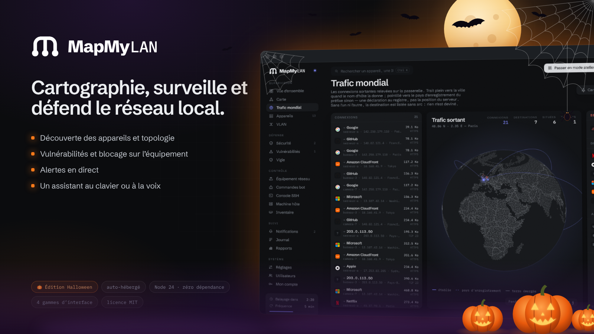
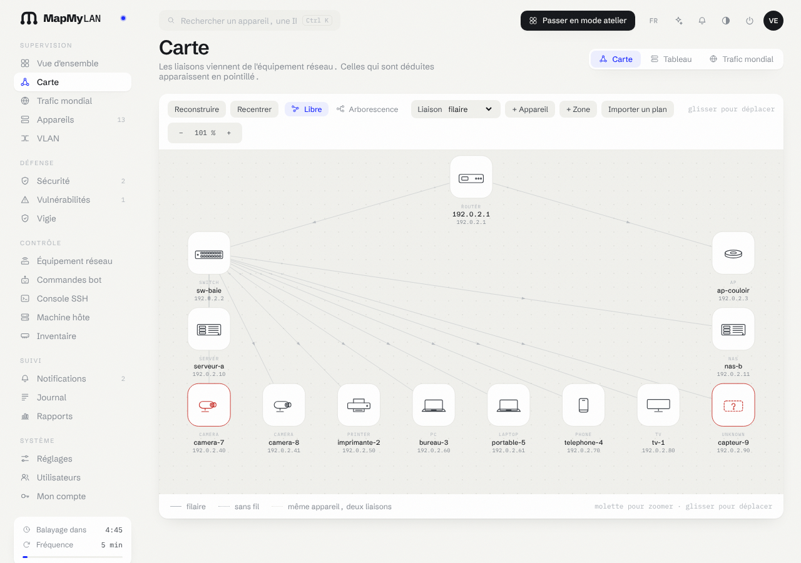
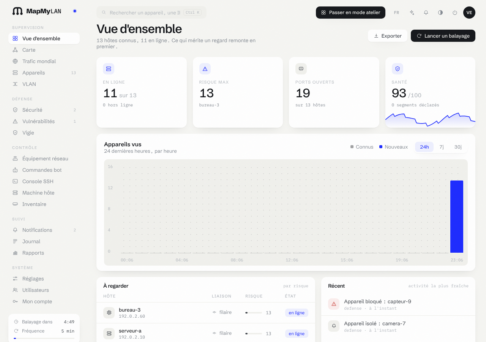
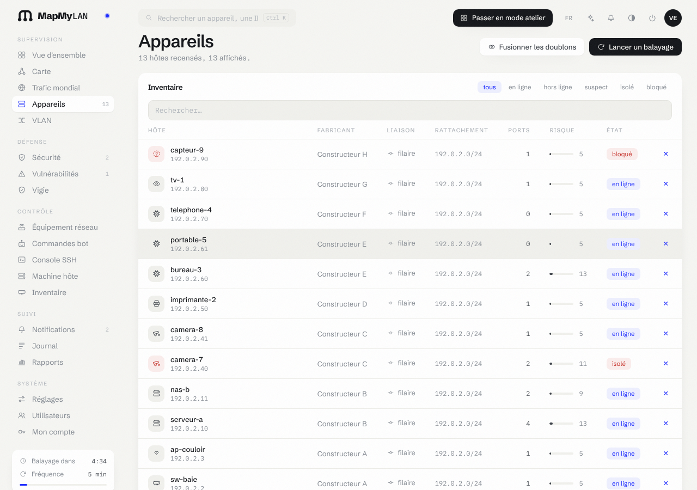
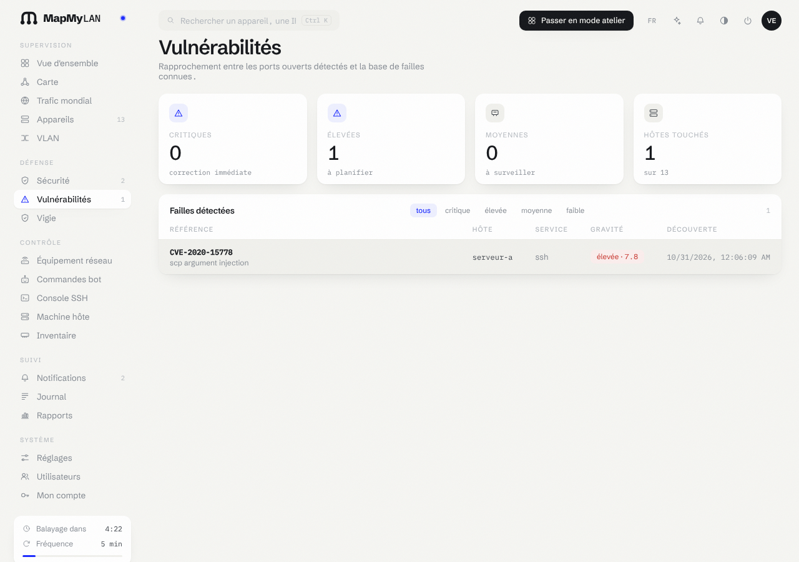

<p align="center">
  <picture>
    <source media="(prefers-color-scheme: dark)" srcset="medias/logo-sombre.svg">
    
  </picture>
</p>

<p align="center"></p>

# MapMyLAN

**Map, monitor and defend your local network — device discovery, real topology, vulnerabilities, and one-click blocking on your own router.**

<p align="center">

[](https://github.com/Nesaris/MapMyLAN/stargazers)
[](LICENSE)


</p>

<p align="center"><a href="README.fr.md">Full documentation</a> · <a href="https://nesaris.github.io">Nesaris Network</a></p>

## Why MapMyLAN?

Most home and small-office networks are a black box: you don't know what's connected, what it talks to, or what's vulnerable. MapMyLAN gives you the full picture and lets you act on it — directly on your network gear.

## Features

- **Device discovery** from three merged sources (ARP scan, ping sweep, and your router/controller), each device identified by a weighted classifier (vendor, mDNS, ports, banners, OS, name) with a confidence score.
- **Scores & CVEs** — trust, activity, vulnerability and danger scores with their reasons; CVEs matched to the services seen; per-device history.
- **Measured topology** — switch port and access point of each client when the gear reports it; unmanaged switches inferred automatically.
- **VLANs & DHCP reservations** read from (and pushed to) your gateway.
- **Defense** — block, isolate or unblock a device by hand or by rule (danger threshold), enforced on the router itself.
- **Traffic** to and from the internet from the gateway's conntrack table, with destination owners via RDAP.
- **Alerts** via Telegram (with bot commands), email or ticketing; "when X, do Y" automations.
- **Assistant** — direct answers without a model, or through Ollama; voice support.
- **Supported gear**: UniFi, Asus/Merlin, OpenWrt, EdgeOS, MikroTik, Cisco IOS, pfSense/OPNsense, Zyxel, generic Linux/iptables.
- **4 UI themes**, light & dark, responsive from 360 to 1920 px.

## Screenshots

<table>
<tr><td align="center" width="50%"><br><sub>Network map</sub></td><td align="center" width="50%"><br><sub>Dashboard</sub></td></tr>
<tr><td align="center" width="50%"><br><sub>Devices</sub></td><td align="center" width="50%"><br><sub>Vulnerabilities</sub></td></tr>
</table>

## Quick start

```bash
git clone https://github.com/Nesaris/MapMyLAN && cd MapMyLAN
cp .env.example .env    # set SCAN_INTERFACE and SCAN_SUBNET
mkdir -p secrets extensions && openssl rand -base64 32 > secrets/socle_cle && : > secrets/socle_cle_ancienne && chmod 600 secrets/socle_cle secrets/socle_cle_ancienne
docker compose up -d --build
docker compose logs mapmylan | grep "Jeton d'installation"   # one-time setup token
```

Open `http://<host>:8090`, paste the setup token, create your account. Or install it from the [Nesaris Hub](https://github.com/Nesaris/Hub) catalog.

Full documentation (configuration, backups, key rotation, reverse proxy, upgrades) is in **[README.fr.md](README.fr.md)**.

## Part of Nesaris Network

MapMyLAN is one of the self-hosted tools of **[Nesaris Network](https://nesaris.github.io)**. Every service shares the same hardened core (accounts, passkeys, TOTP, audit log, encrypted secrets), runs on Node.js 24 with **zero npm dependencies**, and can be installed in one click from the **[Nesaris Hub](https://github.com/Nesaris/Hub)**.

Other projects: [Hub](https://github.com/Nesaris/Hub) · [NexArc](https://github.com/Nesaris/NexArc) · [ProxLab](https://github.com/Nesaris/ProxLab) · [Vigie](https://github.com/Nesaris/Vigie) · [Relay](https://github.com/Nesaris/Relay) · [Nesmail](https://github.com/Nesaris/Nesmail) · [Synapse](https://github.com/Nesaris/Synapse) · [Dialekt](https://github.com/Nesaris/Dialekt)

## Contributing

Issues and pull requests are welcome. If MapMyLAN is useful to you, a ⭐ helps a lot — it's how other people find the project.

## License

[MIT](LICENSE) — made by [CodeX64](https://codexx64.github.io).
